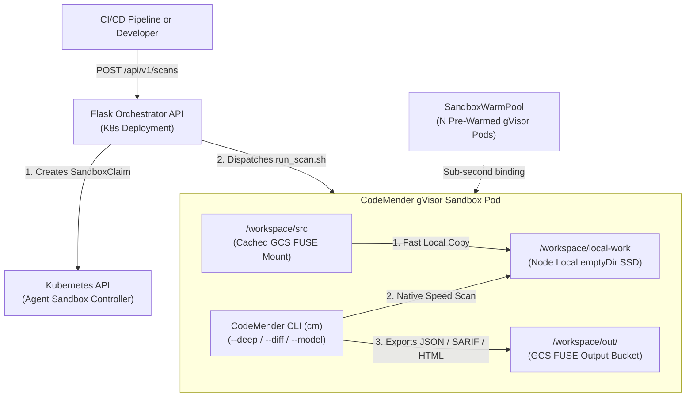

# cm-gke-as
# Scalable CodeMender GKE Agent Sandbox

This repository provides a scalable, secure, and headless architecture for running the Google Cloud CodeMender client (`cm`) inside isolated **Google Kubernetes Engine (GKE) Agent Sandboxes (gVisor)** orchestrated by a **Python + Flask REST API**.

## Architecture & Scalability Improvements

### Why Direct GCS FUSE Scanning Was Slow (and How This Architecture Fixes It)
1. **Fast Local Ephemeral SSD Staging (`emptyDir`):**
   Running `cm find` directly on a GCS FUSE mount (`/workspace/src`) translates every POSIX directory walk, `grep`, `read_file`, and compiler call into remote HTTP requests over gVisor's user-space kernel. In this scalable design, [`worker/run_scan.sh`](worker/run_scan.sh) stages the target codebase from `/workspace/src/<target>` into node-local ephemeral SSD storage (`/workspace/local-work/<scan_id>`) before running CodeMender, eliminating GCS FUSE I/O latency during scanning.
2. **No Shared `ReadWriteOnce` PVC Bottleneck:**
   Each sandbox pod uses its own isolated `emptyDir` workspace (`10Gi` limit) and isolated `CM_HOME` SQLite database instead of a single shared `ReadWriteOnce` PVC. This allows the `SandboxWarmPool` to scale horizontally across multiple GKE Autopilot nodes without `Multi-Attach` volume errors.
3. **Headless Python/Flask Orchestrator API:**
   Instead of manually running `kubectl exec` via `connect.sh` into a single pod, the **Flask Orchestrator Service** ([`orchestrator/app.py`](orchestrator/app.py)) exposes a REST API (`/api/v1/scans`). Each scan request dynamically creates a `SandboxClaim` (`extensions.agents.x-k8s.io/v1alpha1`), binds to a pre-warmed gVisor pod in under a second, runs the staged scan headlessly (`quick`, `deep` with parallel workers, or `diff`), exports `JSON`, `SARIF`, `HTML`, and `Markdown` reports to the GCS output bucket, and releases the claim when finished.



## Prerequisites

1. **Google Cloud SDK (`gcloud`)** installed and authenticated.
2. **Terraform** (`>= 1.3.0`) installed.
3. **Docker** installed (for building the worker and orchestrator images).
4. **envsubst** installed (part of `gettext`).
5. A Google Cloud Project with billing enabled.

## Deployment Instructions

### 1. Set Environment Variables

```bash
export PROJECT_ID="[YOUR_PROJECT_ID]"
export LOCATION="us-central1"       # Optional, defaults to us-central1
export PREFIX="cm-sandbox"          # Optional, defaults to cm-sandbox
export WARMPOOL_REPLICAS="3"        # Number of pre-warmed gVisor sandboxes
```

### 2. Run the Deployment Script

The [`deploy.sh`](deploy.sh) script automates the entire deployment:
1. Provisions infrastructure via Terraform (VPC, Private Service Connect, Private DNS, Artifact Registry, GKE Autopilot with Agent Sandbox, Workload Identity, and GCS buckets).
2. Builds and pushes both the `codemender-worker` and `codemender-orchestrator` Docker images.
3. Deploys the Kubernetes RBAC, `SandboxTemplate` (with local `emptyDir` staging and GCS FUSE caching), `SandboxWarmPool`, and `codemender-orchestrator` Deployment.

```bash
./deploy.sh
```

## Triggering Scalable Scans via the Flask Orchestrator API

### 1. Upload Source Code to the Source Bucket

```bash
gcloud storage cp -r my-project/ gs://${SRC_BUCKET}/my-project/
```

### 2. Port-Forward or Expose the Orchestrator Service

```bash
kubectl port-forward svc/codemender-orchestrator-svc 8080:80
```

### 3. Submit Concurrent Scans (`POST /api/v1/scans`)

#### Quick Scan (Default, with fast model)
```bash
curl -X POST http://localhost:8080/api/v1/scans \
  -H "Content-Type: application/json" \
  -d '{
    "target_path": "my-project",
    "scan_mode": "quick",
    "model": "gemini-3.8-flash"
  }'
```

#### Exhaustive Multi-Worker Deep Scan (`--deep`)
```bash
curl -X POST http://localhost:8080/api/v1/scans \
  -H "Content-Type: application/json" \
  -d '{
    "target_path": "my-project",
    "scan_mode": "deep",
    "workers": 8,
    "model": "gemini-3.8-flash"
  }'
```

#### PR / CI Delta Scan (`--diff`)
```bash
curl -X POST http://localhost:8080/api/v1/scans \
  -H "Content-Type: application/json" \
  -d '{
    "target_path": "my-project",
    "scan_mode": "diff",
    "diff_ref": "origin/main",
    "workers": 4
  }'
```

### 4. Check Scan Status & Retrieve Reports (`GET /api/v1/scans/<scan_id>`)

```bash
# Check status and timing breakdown (staging_duration_seconds vs scan_duration_seconds)
curl http://localhost:8080/api/v1/scans/<scan_id>

# Download exported reports from the GCS output bucket
gcloud storage cp -r gs://${OUT_BUCKET}/<scan_id>/ ./reports/
```

## Running Unit Tests Locally

```bash
PYTHONPATH=. python3 -m unittest discover -s tests -v
```

## Interactive Debugging (Optional)

If you still want to open an interactive shell inside a sandbox pod for manual testing:
```bash
kubectl apply -f k8s/sandbox-claim.yaml
./connect.sh
```

## Clean Up

To avoid incurring charges, destroy the infrastructure when finished:

```bash
cd terraform
terraform destroy -var="project_id=${PROJECT_ID}"
```
